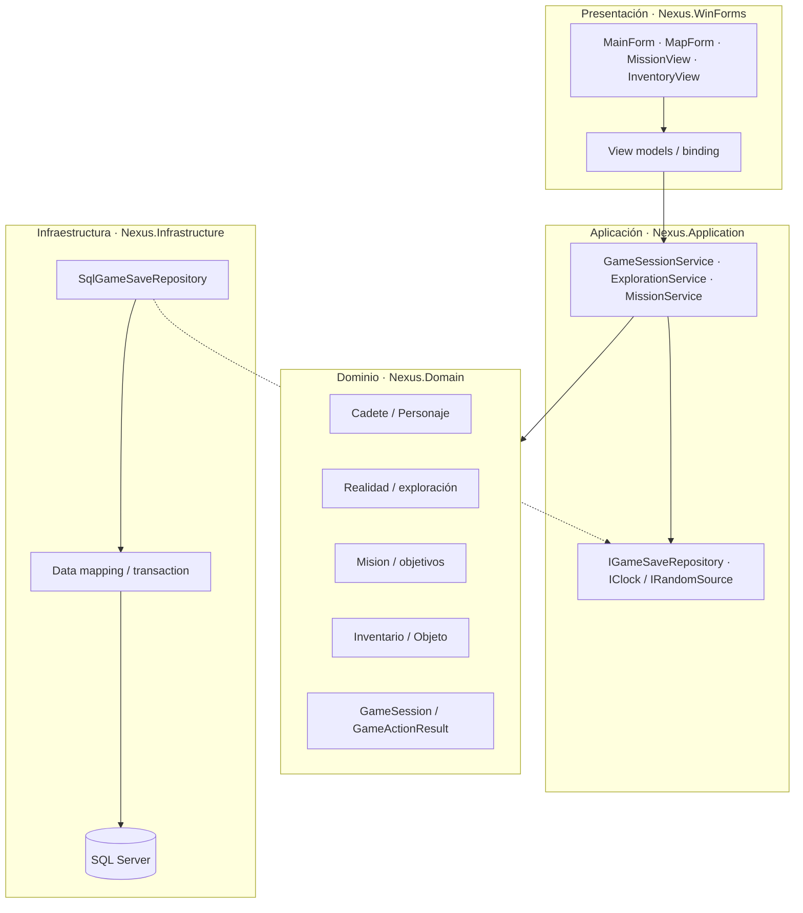

# Arquitectura propuesta

## Decisión

Aplicación de escritorio Windows Forms sobre .NET moderno (proyecto `netX.0-windows`, `UseWindowsForms=true`) y SQL Server para partidas. Mantener dominio independiente de Windows Forms y del proveedor SQL. Para una solución pequeña y mantenible, empezar con tres proyectos: `Nexus.Domain`, `Nexus.Application`, `Nexus.Infrastructure` y un ejecutable WinForms `Nexus.WinForms`; si el curso exige un único `.csproj`, separar inicialmente en carpetas/namespace con límites equivalentes y extraer proyectos cuando haya estabilidad.

## Diagrama

Dependencias: WinForms depende de Application y Domain; Application depende de Domain y contratos; Infrastructure implementa contratos; Domain no depende de UI, SQL ni infraestructura. La composición/registro de dependencias se hace al inicio del ejecutable.

## Responsabilidades y migración desde H3

1. Mover `TipoObjeto`, `Objeto`, sus cinco derivados, `Inventario`, `Personaje`, `Cadete`, `Robot`, `Enemigo`, `Realidad` y `Mision` desde `Program.cs` a `Nexus.Domain`. Mantener primero reglas conocidas; cambiar métodos que imprimen por resultados como `ExplorationResult` o `CombatResult` con estado, evento y razón.
2. Extraer el estado global estático de `Program` a `GameSession`: realidad actual, dos realidades, cadete, misión, enemigo/encuentro activo y flags hoy separadas (`tieneNucleo`, `jefeDerrotado`). Centralizar esas banderas en entidad de misión/encuentro para evitar estados contradictorios.
3. Crear servicios de aplicación para `Explorar`, `CambiarRealidad`, `UsarObjeto`, `AnalizarAnomalia`, `BuscarNucleo`, `Extraer`, `Combatir`, `Guardar` y `Cargar`. Cada caso valida precondiciones, ejecuta reglas y retorna una respuesta que la pantalla presenta.
4. Convertir el menú en formularios/vistas WinForms. Eventos de botones llaman a servicios y actualizan binding; no replican reglas en controladores. Una capa de navegación cambia paneles, sin reinstanciar mundo accidentalmente.
5. Implementar `IGameSaveRepository` en Infrastructure usando `Microsoft.Data.SqlClient`; guardar/cargar se llama desde servicio, no desde formulario ni entidad.

## Interfaz y ciclo de eventos

El hilo UI de WinForms no debe bloquearse con esperas del antiguo `Thread.Sleep` ni consultas lentas. Usar `async` para operaciones de datos y actualizar controles desde el contexto UI. SQL remoto lento puede mostrarse como estado de carga con botón deshabilitado durante esa operación. Las transiciones de juego pequeñas son síncronas inicialmente; si se ejecutan fuera del hilo UI, devolver un resultado completo y actualizar en el hilo propietario.

La aplicación arranca leyendo configuración segura, construye repositorio/servicios y abre menú. Al cargar una partida, el servicio rehidrata `GameSession`, y la UI pinta el modelo. Tras una acción válida, se actualiza la pantalla; auto-guardado se considera tras una unidad coherente (fin del evento/combate o extracción) y se puede ofrecer botón Guardar explícito. Debe acordarse una política contra sobrescritura concurrente si se añaden varios procesos/dispositivos.

## Ventajas y costos

Las reglas se prueban/razonan sin abrir formularios; WinForms sirve al objetivo Windows y permite controles nativos, diseñador visual y data binding. El repositorio permite sustituir SQL por memoria durante desarrollo. Separar proyectos agrega archivos/configuración iniciales, pero limita crecimiento de un `Program.cs` monolítico y evita que SQL condicione el juego. SQL Server local no garantiza nube/portabilidad; es una dependencia explícita del requisito.

## Migración por hitos

1. Inventariar reglas, definir resultados tipados y sacar clases de dominio del `Program.cs`.
2. Sustituir consola por WinForms manteniendo almacenamiento en memoria y lograr el ciclo completo de la misión.
3. Modelar/crear esquema SQL, implementar repositorio y guardado transaccional; cargar/guardar una partida de prueba manualmente.
4. Añadir errores de conexión recuperables, verificación de integridad, configuración, accesibilidad y pulido visual.

Cada hito conserva una compilación ejecutable y evita mezclar rediseño de reglas, interfaz y base de datos en un único cambio.
