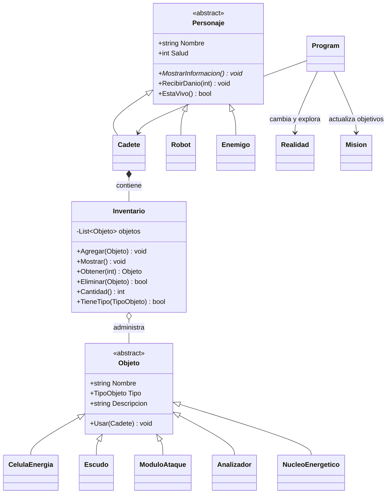
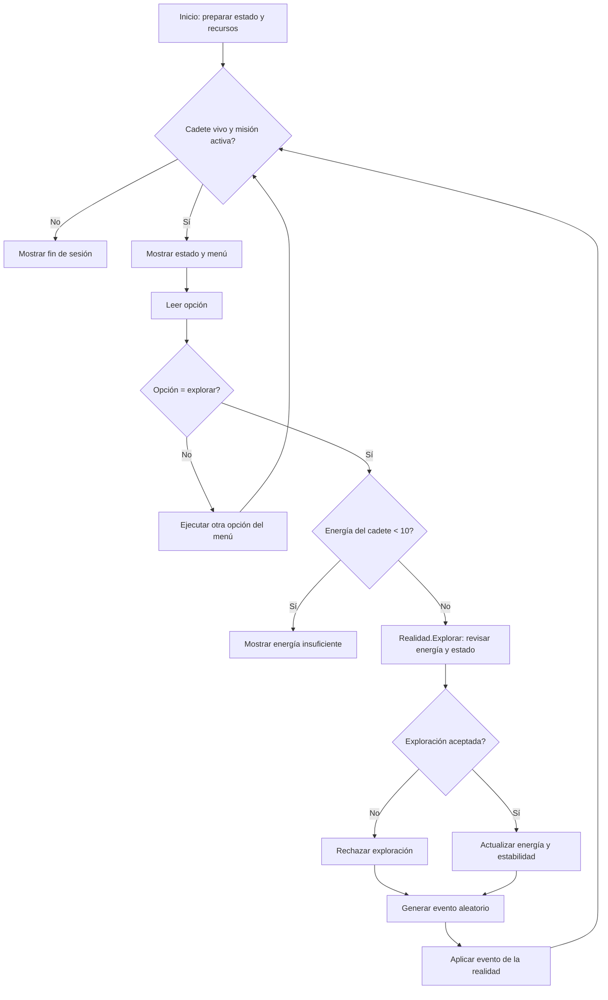

# Diagramas de NEXUS

Los diagramas describen el código de `Program.cs`. Mermaid permite verlos en GitHub y en editores compatibles.

## Clases y relaciones

## Flujo de exploración

Nota de análisis: el método `Program.Explorar()` llama a `GenerarEvento()` después de `Realidad.Explorar()` sin recibir un resultado que indique si esta última aceptó la exploración. Por eso, con energía suficiente pero estadísticas demasiado bajas, se puede rechazar la exploración y aun así generar un evento. Es una oportunidad de mejora del diseño.

