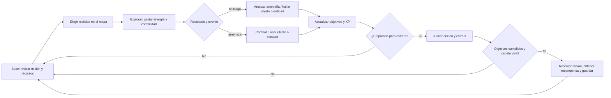

# Diseño del juego: NEXUS

**Documento de diseño de experiencia · evolución de H3**

## Visión

NEXUS será una aventura gráfica de exploración y supervivencia en la que una cadete investiga anomalías entre realidades conectadas. El jugador lee señales, elige cuándo explorar, administra recursos, analiza amenazas y decide si está preparado para extraer un núcleo. La tensión nace de que explorar aporta pistas y progreso, pero consume energía y deteriora tanto a la cadete como al mundo. Continuar permite descubrir qué pasó con la anomalía; sobrevivir y volver con el núcleo convierte esa curiosidad en una decisión táctica.

La versión propuesta conserva el escenario, la misión «La anomalía perdida», la cadete, el mapa entre R-17 y R-18, sus estadísticas, los objetos, el robot, los enemigos, los eventos y la extracción que ya existen en `Program.cs`. Se transforma la presentación por consola en una interfaz Windows Forms y se da continuidad al progreso con SQL Server.

## Ciclo principal



Secuencia de una salida: **leer el estado → planear destino → explorar → responder al evento → revisar objetivos e inventario → reabastecer o cambiar de realidad → extraer cuando los requisitos estén listos → ver resumen y continuar**. El mapa ofrece retorno a la otra realidad; no es una pantalla separada de la toma de decisiones.

## Mecánicas y reglas

### Exploradores y supervivencia

El protagonista jugable de H3 es `Cadete`, derivado de `Personaje`; no hay un equipo controlable de varios exploradores. La primera versión gráfica conserva un único cadete para no inventar una gestión de grupo ajena al código. En pantalla se llama “Cadete” o “exploradora”, según la identificación narrativa que se configure.

Se muestran salud, energía, estabilidad, escudo y XP. Los topes iniciales son 100 para salud, energía y estabilidad, escudo inicial 50. `Cadete.RecibirDanioCadete` hace que el escudo absorba daño antes de la salud. Si salud llega a cero, la partida termina con derrota. Los recursos deben verse numéricamente y con barras, y cada variación comunica el valor anterior y el nuevo.

### Realidades y exploración

Se conservan las dos ubicaciones iniciales de `Program`: **R-17 Ciudad de los Ecos** (estabilidad 90, riesgo 15) y **R-18 Sector de las Sombras** (estabilidad 60, riesgo 35). `Realidad.Explorar` determina el resultado por energía y estabilidad de la cadete: con ambos recursos ≥70 la exploración es segura (energía −(10 + riesgo), estabilidad −3 si riesgo ≤20 o −5 en otro caso; realidad −2); con ambos ≥40 es inestable (energía −(15 + riesgo), estabilidad −(6 + riesgo/10); realidad −5); por debajo de esos umbrales se rechaza. Los valores se limitan a 0–100 donde el método actual lo hace.

El mapa visual representa esas realidades y marca cuál está activa, su riesgo/estabilidad, anomalía, núcleo y extracción solo cuando el estado del juego ya lo permite. Cambiar realidad se conserva como acción explícita. El texto deja claro el costo estimado antes de confirmar una exploración. La implementación debe resolver el defecto actual: `Program.Explorar()` puede disparar `GenerarEvento()` después de que `Realidad.Explorar()` rechace la acción; la lógica nueva devolverá un resultado explícito y solo generará eventos si corresponde.

### Misiones y progresión

La misión inicial `Mision("La anomalía perdida")` requiere anomalía encontrada, núcleo encontrado, enemigo superado y extracción realizada; `Mision.Verificar()` determina la finalización. La pantalla de misión muestra los cuatro pasos como objetivos claros, pendientes o completos. `AnalizarAnomalia`, `BuscarNucleo`, `Extraer` y el combate conservan sus condiciones y efectos reales de H3. No se promete contenido narrativo o misiones que aún no están implementadas.

`Cadete.AgregarXP` registra XP. La experiencia gráfica mostrará XP ganado en el resumen. Niveles y desbloqueos son una ampliación opcional: XP no se convertirá en niveles sin definir fórmulas y recompensas verificables.

### Inventario, objetos y eventos

`Inventario` conserva `List<Objeto>` y operaciones de agregar, consultar, eliminar y comprobar tipo. La sesión comienza con célula de energía, escudo y analizador. La célula restaura 25 de energía hasta 100; el escudo restaura 30 hasta 100; el módulo de ataque añade 15 al daño siguiente. El analizador prepara análisis y el núcleo es un objetivo de misión, no un consumible general. La interfaz muestra cantidad, descripción, efecto y acción disponible. Un uso inválido explica por qué no procede. La regla debe consumir el objeto solo cuando su uso tuvo efecto; H3 puede retirar una célula incluso si el cadete ya está al máximo.

El bucle de menú genera eventos aleatorios con `GenerarEvento` después de explorar, incluyendo objetos, robots, enemigos y anomalía según sus métodos. Combate ofrece atacar, usar objeto, analizar o escapar; los mensajes de consola se convierten en registro de eventos y cuadros de decisión no bloqueantes.

## Pantallas y navegación

La ventana principal usa una barra superior con identificación/partida y recursos persistentes, navegación lateral y panel central intercambiable. Las pantallas abren desde el menú y permiten volver a Base sin perder el contexto de misión. Confirmaciones/descripciones nunca dependen solo del color. Teclado: Tab recorre controles, Enter activa acción principal, Escape vuelve/cancela; atajos visibles opcionales.

### 1. Menú principal / Base

```text
┌──────────────────────────── NEXUS ──────────────────────────────┐
│ NEXUS-CADETE-01       SALUD ██████████ 100   ENERGÍA ██████ 62 │
│                         ESCUDO 40   ESTABILIDAD 74   XP 35      │
├──────────────────┬──────────────────────────────────────────────┤
│ ▶ Continuar       │  AÑO 2297 · CENTRO DE OPERACIONES            │
│   Nueva partida   │  Misión activa                               │
│   Explorar mapa   │  LA ANOMALÍA PERDIDA                         │
│   Misiones        │  Investiga la señal en R-17 y R-18.           │
│   Cadete e items  │  [Continuar expedición]                       │
│   Salir           │  Último informe: extracción aún pendiente     │
└──────────────────┴──────────────────────────────────────────────┘
```

Acciones: continuar partida guardada, iniciar desde cero con confirmación, abrir las cuatro áreas, salir. Estado: misión y recursos resumidos; no se ofrece “continuar” sin una partida.

### 2. Exploración / mapa

```text
┌─ MAPA DE REALIDADES ─────────────────────────────────────────────┐
│ [R-17 · ACTIVA] ─────── portal ─────── [R-18]                   │
│ Ciudad de los Ecos                         Sector de las Sombras  │
│ Estabilidad 90 · Riesgo 15               Estabilidad 60 · Riesgo 35│
│   ● anomalía detectada                       ? señal débil        │
├─────────────────────────────────────────────────────────────────┤
│ Costo estimado: 25 energía · exploración segura                 │
│ [Explorar R-17] [Cambiar realidad] [Ver informe]                │
│ Registro: “R-17: rastros de energía cerca del distrito central.” │
└─────────────────────────────────────────────────────────────────┘
```

El destino activo tiene borde y texto “ACTIVA”. Cada región es un control con nombre accesible; el diagrama comunica conexión, no exige arrastrar un personaje. Al explorar, se muestra costo y resultado, después se actualizan recursos y registro. Si no hay energía, se desactiva la acción con explicación y alternativa “volver a base”.

### 3. Misiones

```text
┌─ REGISTRO DE MISIONES ───────────────────────────────────────────┐
│ ACTIVA · LA ANOMALÍA PERDIDA                Progreso: 2/4        │
│ Investiga la anomalía y regresa con vida.                        │
│ [✓] Encontrar anomalía        [✓] Recuperar núcleo energético    │
│ [ ] Superar al enemigo         [ ] Realizar extracción           │
│                                                                  │
│ Siguiente paso recomendado: dirígete al punto de extracción una  │
│ vez superada la amenaza.           [Abrir mapa] [Volver a base]   │
└─────────────────────────────────────────────────────────────────┘
```

Los checklists salen de `Mision` y solo indican “completa” si el estado en memoria lo confirma. Para datos sin requisitos cumplidos, se explican los que faltan. La misión resuelta abre un resumen antes de guardar.

### 4. Cadete / inventario

```text
┌─ CADETE E INVENTARIO ────────────────────────────────────────────┐
│ NEXUS-CADETE-01        NIVEL — (no implementado)    XP 35        │
│ Salud 100/100 · Energía 62/100 · Estabilidad 74/100 · Escudo 40 │
├────────────────────────────┬────────────────────────────────────┤
│ INVENTARIO (3)              │ Célula de energía                  │
│ ▣ Célula de energía (1)     │ Restaura hasta 25 energía.          │
│ ▣ Escudo (1)                │ [Usar] [Inspeccionar]               │
│ ▣ Analizador (1)            │                                    │
│ ▣ Módulo de ataque (0)      │ Historial de cambios y efectos      │
│ ▣ Núcleo energético (0)     │                                    │
└────────────────────────────┴────────────────────────────────────┘
```

Se selecciona un objeto de lista y se muestran descripción y efecto. Cantidad cero indica tipo conocido que todavía no se obtuvo, si el diseño decide mostrarlo; no se confunde con objeto poseído. La pantalla de cadete conserva información completa del `MostrarInformacion` de `Personaje` y estado mostrado en `MostrarEstadoCompleto`.

## Criterios de experiencia

- **Legibilidad:** tipografía de interfaz de 12 pt como mínimo en escala 100%, títulos mayores; alto contraste y escalado de Windows; textos breves, vocabulario consistente (“energía”, “estabilidad”, “realidad”).
- **Jerarquía:** recursos y destino primero; objetivo activo después; detalles, registro y acciones secundarias al final. Una acción primaria destacada por pantalla.
- **Consistencia:** mismas ubicaciones, nombres, iconos y términos para una entidad en todas las pantallas; controles WinForms comunes y patrones repetidos para confirmar/cancelar.
- **Navegación:** panel de navegación persistente, encabezado de destino y salida clara; no abrir ventanas modales para operaciones normales; mantener pantalla/selección tras errores.
- **Retroalimentación:** cada acción confirma aceptación/rechazo, costo y cambio de estado; mostrar mensajes inline y registro cronológico; pedir confirmación solo para salir/perder progreso o reiniciar.
- **Accesibilidad:** controles etiquetados, orden de tabulación, foco visible, atajos descubiertos en etiqueta y significado redundante a color/ícono.

## Alcance y restricciones

### Prioridad de implementación

1. Ventana base con menú, recursos, navegación y partida en memoria.
2. Mapa con R-17/R-18, exploración y eventos controlados por lógica independiente de formularios.
3. Misión, combate, inventario, análisis, búsqueda y extracción alineados con las reglas H3.
4. Guardar/cargar partida en SQL Server, con transacción para estado y pertenencias al inventario.
5. Registro de acciones, manejo de error de conexión y mensajes recuperables.

### Opcional

Ilustraciones/animaciones, música, editor de avatar, varias cadetes, más realidades/misiones, árbol de niveles y logros, guardado en la nube. Estas tareas vienen después de estabilizar reglas, persistencia y navegación.

### Límites

Windows Forms limita la plataforma a Windows; es apropiado para esta entrega de escritorio y su alcance, no un motor 3D. La interfaz no debe contener reglas de combate/exploración ni SQL en sus eventos. SQL Server requiere instancia accesible y configuración externa; no incluir credenciales en Git. El código H3 vive concentrado en `Program.cs`, conserva estado global estático y no persiste. La solución debe refactorizar gradualmente sin cambiar la misión base ni atribuir al programa funcionalidades solo descritas como futuras.

## Evidencias visuales

Los cuatro wireframes anteriores están reproducidos como hojas Markdown en [`evidencias/wireframes.md`](evidencias/wireframes.md) para poder revisarlos directamente en GitHub.
