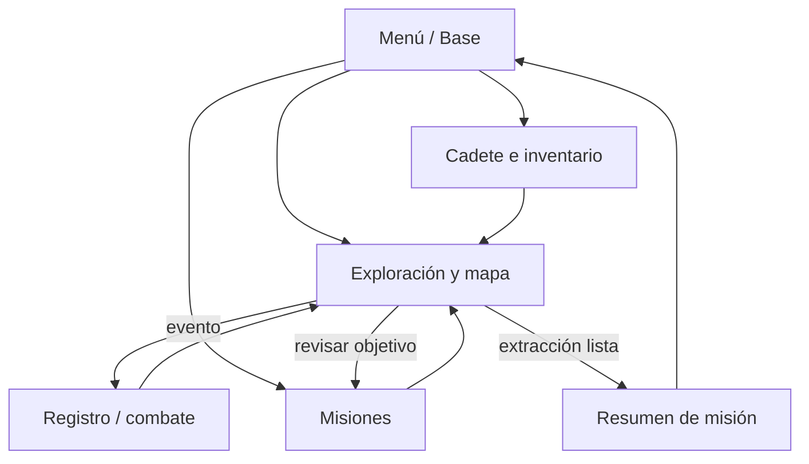

# Evidencias de diseño: wireframes NEXUS

Estos bocetos son de baja fidelidad y describen controles, contenido y navegación previstos. Las cifras son valores ilustrativos de estado, no balance definitivo. El juego inicial conserva sus dos realidades, misión única, recursos y clases de objetos de H3.

## Menú principal / Base

```text
┌──────────────────────────── NEXUS ──────────────────────────────┐
│ NEXUS-CADETE-01       SALUD ██████████ 100   ENERGÍA ██████ 62 │
│                         ESCUDO 40   ESTABILIDAD 74   XP 35      │
├──────────────────┬──────────────────────────────────────────────┤
│ ▶ Continuar       │  AÑO 2297 · CENTRO DE OPERACIONES            │
│   Nueva partida   │  Misión activa · LA ANOMALÍA PERDIDA          │
│   Explorar mapa   │  Investiga la señal en R-17 y R-18.           │
│   Misiones        │  [Continuar expedición]                       │
│   Cadete e items  │  Último informe: extracción aún pendiente     │
│   Salir           │                                              │
└──────────────────┴──────────────────────────────────────────────┘
```

## Exploración / mapa

```text
┌─ MAPA DE REALIDADES ─────────────────────────────────────────────┐
│ [R-17 · ACTIVA] ─────── portal ─────── [R-18]                   │
│ Ciudad de los Ecos                         Sector de las Sombras  │
│ Estabilidad 90 · Riesgo 15               Estabilidad 60 · Riesgo 35│
│   ● anomalía detectada                       ? señal débil        │
├─────────────────────────────────────────────────────────────────┤
│ Costo estimado: 25 energía · exploración segura                 │
│ [Explorar R-17] [Cambiar realidad] [Ver informe]                │
│ Registro: rastros de energía cerca del distrito central.        │
└─────────────────────────────────────────────────────────────────┘
```

## Misiones

```text
┌─ REGISTRO DE MISIONES ───────────────────────────────────────────┐
│ ACTIVA · LA ANOMALÍA PERDIDA                Progreso: 2/4        │
│ Investiga la anomalía y regresa con vida.                        │
│ [✓] Encontrar anomalía        [✓] Recuperar núcleo energético    │
│ [ ] Superar al enemigo         [ ] Realizar extracción           │
│ Siguiente paso: dirígete al punto de extracción cuando sea seguro.│
│                                      [Abrir mapa] [Volver a base]│
└─────────────────────────────────────────────────────────────────┘
```

## Cadete / inventario

```text
┌─ CADETE E INVENTARIO ────────────────────────────────────────────┐
│ NEXUS-CADETE-01        NIVEL — (no implementado)    XP 35        │
│ Salud 100/100 · Energía 62/100 · Estabilidad 74/100 · Escudo 40 │
├────────────────────────────┬────────────────────────────────────┤
│ INVENTARIO (3)              │ Célula de energía                  │
│ ▣ Célula de energía (1)     │ Restaura hasta 25 energía.          │
│ ▣ Escudo (1)                │ [Usar] [Inspeccionar]               │
│ ▣ Analizador (1)            │                                    │
│ ▣ Módulo de ataque (0)      │ Historial de cambios y efectos      │
│ ▣ Núcleo energético (0)     │                                    │
└────────────────────────────┴────────────────────────────────────┘
```

## Mapa de navegación


