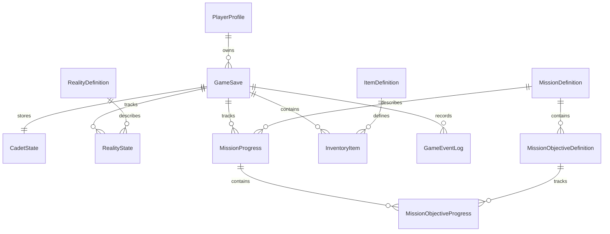

# Modelo de datos propuesto para SQL Server

## Objetivo de persistencia

H3 inicia cada ejecución con un cadete, dos realidades y una misión nuevas; no contiene guardado/carga. La siguiente etapa debe permitir elegir una partida, cerrarla y reconstruir exactamente el estado de la exploración, incluyendo objetivos y objetos. Persistir identificadores estables y valores de dominio, no texto de consola ni nombres de clase CLR.

## Entidades y relaciones



| Tabla | Campos principales | Uso |
|---|---|---|
| `PlayerProfile` | `PlayerId` PK, `DisplayName`, `CreatedAtUtc` | Perfil local sencillo. Evitar autenticación/red de cuentas en la primera versión. |
| `GameSave` | `SaveId` PK, `PlayerId` FK, `SaveName`, `CurrentRealityCode`, `SaveVersion`, `CreatedAtUtc`, `UpdatedAtUtc`, `RowVersion` | Raíz de partida y control optimista de concurrencia. `PlayerId` permite varias partidas. |
| `CadetState` | `SaveId` PK/FK, `Name`, `Health`, `Energy`, `Stability`, `Shield`, `XP`, `ExtraDamage` | Estado actual de `Cadete`; valores con restricciones 0–100 donde corresponde. |
| `RealityDefinition` | `RealityCode` PK, `Name`, `InitialStability`, `RiskLevel` | Catálogo para R-17/R-18 y futuras realidades. |
| `RealityState` | (`SaveId`,`RealityCode`) PK, FK compuesta a `GameSave`, FK a realidad, `Stability`, `CurrentState` opcional derivable | Estabilidad por partida; riesgo/nombre provienen del catálogo. Guardar estado solo si puede cambiar. |
| `MissionDefinition` | `MissionId` PK, `Code` UNIQUE, `Name`, `Description`, `DefinitionVersion` | Definición estable de «La anomalía perdida». |
| `MissionObjectiveDefinition` | `ObjectiveId` PK, `MissionId` FK, `Code`, `DisplayOrder`, `Description`, `IsRequired` | Objetivos: anomalía, núcleo, enemigo, extracción. `Code` único por misión. |
| `MissionProgress` | `MissionProgressId` PK, `SaveId` FK, `MissionId` FK, `Status`, `StartedAtUtc`, `CompletedAtUtc` NULL | Estado de misión activa/completada en una partida. |
| `MissionObjectiveProgress` | (`MissionProgressId`,`ObjectiveId`) PK, FKs, `IsComplete`, `CompletedAtUtc` NULL | Reemplaza los cuatro bools de `Mision` con registros referidos a definiciones. |
| `ItemDefinition` | `ItemId` PK, `Code` UNIQUE, `Name`, `Description`, `ItemType`, `IsStackable` | Catálogo estable de célula, escudo, módulo, analizador, núcleo. No persistir subclase por nombre. |
| `InventoryItem` | `InventoryItemId` PK, `SaveId` FK, `ItemId` FK, `Quantity`, `Slot` NULL, `StateJson` NULL opcional | Pertenencias a inventario. H3 usa objetos individuales; usar cantidad solo si se confirma que son fungibles y no guardan estado individual. Núcleo puede ser item único/cantidad uno. |
| `GameEventLog` (opcional) | `EventId` PK, `SaveId` FK, `OccurredAtUtc`, `EventCode`, `Message`, `RealityCode` NULL | Historial visible; no usar el log como fuente autoritativa de estado. Limitar longitud/retención. |

No se propone guardar enemigos transientemente hasta confirmar si la sesión puede guardarse a mitad del combate. Si ese requisito aparece, agregar `EncounterState` y participantes en vez de serializar gráficamente todo el mundo.

## Diagrama lógico de claves

```text
PlayerProfile (1) ─── (N) GameSave (1) ─── (1) CadetState
                                 ├──────── (N) RealityState ── (1) RealityDefinition
                                 ├──────── (N) MissionProgress ─ (1) MissionDefinition
                                 │                  └── (N) MissionObjectiveProgress
                                 ├──────── (N) InventoryItem ─── (1) ItemDefinition
                                 └──────── (N) GameEventLog
```

`GameSave.CurrentRealityCode` debe tener FK a `RealityDefinition`; `RealityState` tiene PK compuesta `(SaveId, RealityCode)`. Activar las claves y restricciones en SQL Server evita estados huérfanos; una FK no crea automáticamente índice en sus columnas, de modo que indexar FKs usadas en carga/consulta.

## Guardar y recuperar

### Guardar

1. El servicio de aplicación valida sesión y genera un snapshot consistente (`GameSaveSnapshot`) con los recursos, la realidad activa, ambas estabilidades, misión/objetivos e inventario.
2. Abrir `SqlConnection` desde configuración externa y comenzar `SqlTransaction`.
3. Insertar/actualizar `GameSave`, `CadetState`, estados de realidades, progreso/objetivos e inventario usando parámetros `@...` y `Microsoft.Data.SqlClient`; eliminar o reemplazar colecciones dentro de la transacción para impedir guardar solo parte del inventario.
4. Confirmar transacción solo si todas las escrituras terminan bien; ante error hacer rollback y mantener en memoria el estado jugado, informando “no se guardó” y ofreciendo reintento.
5. Actualizar `UpdatedAtUtc` y respetar `RowVersion` para detectar que otra instancia cambió el guardado.

### Cargar

Consultar la partida por `SaveId` y perfil, materializar snapshot por agregados y validar `SaveVersion`. Comprobar que existan las dos realidades referidas, que los límites sean válidos, que el objetivo/item pertenezca a su definición y que exista exactamente la sesión activa esperada. Rehidratar `Cadete`, `Inventario`, `Realidad`, `Mision` y `GameSession` mediante métodos/fábricas explícitas; no exponer setters públicos solo para ORM. Si hay versión desconocida, corrupción o versión antigua sin migración, ofrecer mensaje claro y no sobrescribir con datos parciales.

El tiempo se almacena como UTC; configuración de conexión/secretos no se guarda en el repositorio. En un juego local de un solo usuario basta Windows Authentication/SQL Server local para el desarrollo; el proveedor y la cadena concreta se definen según entorno de despliegue.

## Integridad y decisiones

- PK, FK y `UNIQUE` para identidad y pertenencias; `CHECK` para recursos ≥0 y ≤100, cantidad positiva y valores enumerados válidos.
- Transacción de guardado para estado relacionado; parámetros para entradas de SQL; disposición determinista de conexiones/commands.
- Normalizar catálogos frente a inventario/estado evita repetir nombres y descripciones en cada save. `GameEventLog` es opcional y no sustituye progreso normalizado.
- `SaveVersion` permite evolucionar el formato con migraciones explícitas. No usar `SELECT *`; declarar columnas y conversiones.
- No guardar contraseña del usuario SQL en texto plano ni secretos en `appsettings` versionado. Configuración local ignorada por Git o autenticación integrada.

Este esquema es propuesta, no una base presente en H3. Ajustar el modelado de stack/cargas individuales al decidir reglas de inventario; mantener la primera implementación sencilla y preservar las entidades actuales.
